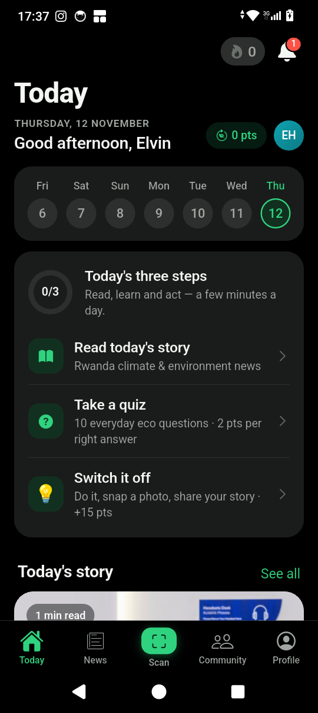
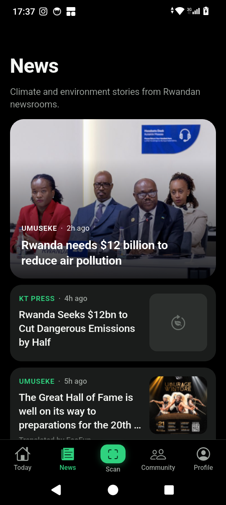
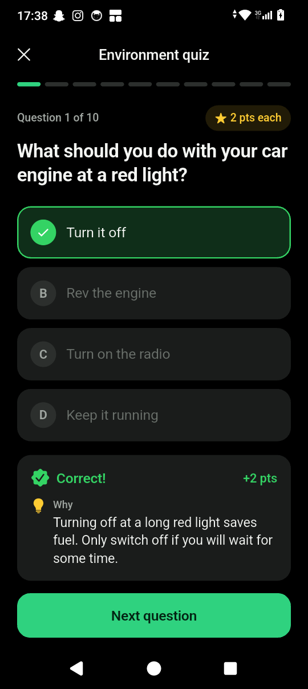
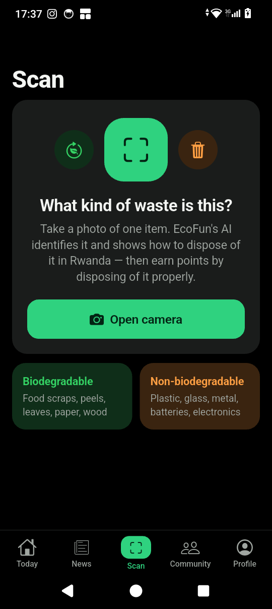
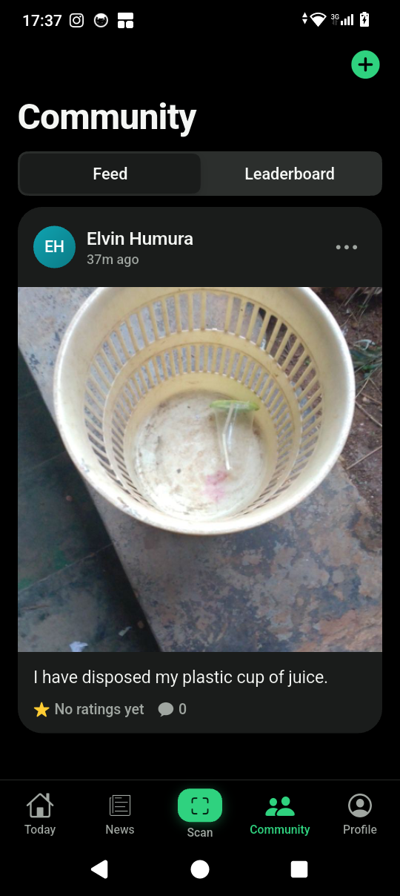
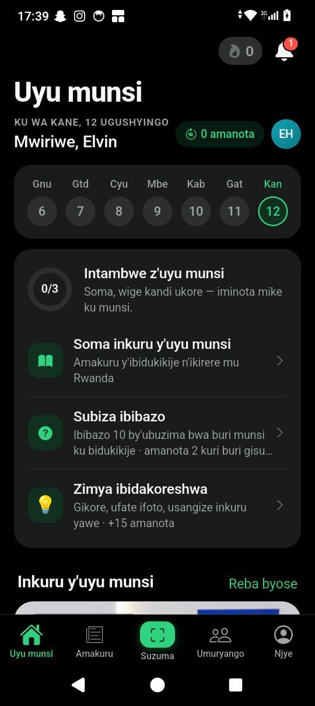
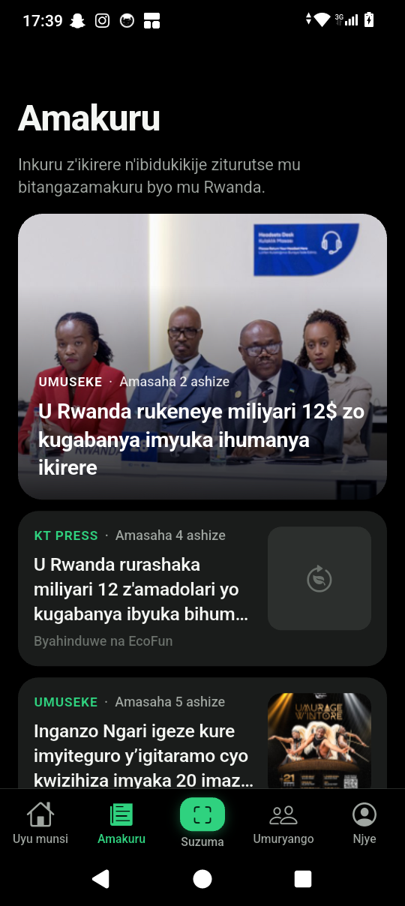

# EcoFun

**Small steps today for a greener Rwanda tomorrow.** 
*Intambwe nto uyu munsi, u Rwanda rutoshye ejo.*

Learn, act and earn points for caring for the environment — in **Kinyarwanda** or **English**.

[Latest release](https://github.com/humuraelvin/EcoFun/releases/latest) · Free · No ads

---

## Download

| Scan with your Android phone | Or open this link on your phone |
|:---:|:---|
|  | **https://github.com/humuraelvin/EcoFun/releases/latest/download/EcoFun.apk**  The link always gives you the newest version. |

### Install on Android (2 minutes)

1. **Download** — open the link above (or scan the QR code) on your Android phone. Your browser downloads `EcoFun.apk`.
2. **Open the file** — tap the download notification, or find `EcoFun.apk` in your *Downloads* / *Files* app.
3. **Allow the install** — Android may say *"For your security, your phone is not allowed to install unknown apps from this source."* Tap **Settings**, turn on **Allow from this source**, then go back.
4. **Install** — tap **Install**, then **Open**.
5. **Choose your language** — *Ikinyarwanda* or *English*. The whole app follows your choice.

> [!IMPORTANT]
> **Google Play Protect may show a warning** such as *"Unsafe app blocked"* or *"App scanned by Play Protect — unknown developer"*.
> This only appears because EcoFun is shared directly instead of through the Play Store. It is safe to continue:
> tap **More details → Install anyway** (or **Install without scanning**). If it asks to send the app for scanning, you can choose **Don't send**.

**Updating:** EcoFun tells you when a new version is ready — tap **Update now**. You stay signed in and keep all your points.

Works on Android 7.0 and newer, including low-cost phones with 2 GB of RAM. Size: about 40 MB.

### iPhone

📱 **The iPhone version is coming soon.** We are working on it — star this repository to be notified when it's ready.

---

## What you can do

| | |
|---|---|
| 🌍 **Read local environment news** | Real climate and environment stories from Rwandan newsrooms (Taarifa, KT Press, Green Africa, Umuseke, Rebero, Izuba), every story available in Kinyarwanda and English. |
| ❓ **Quick, practical quizzes** | Ten everyday questions — where does this go, how do I save water, what should I do with an old battery. Wrong answer? You get the right one, why, and a tip. |
| 📷 **AI waste scanner** | Point your camera at any waste. EcoFun tells you if it is biodegradable, how long it takes to break down and how to dispose of it in Rwanda. |
| ♻️ **Points for disposing properly** | Photograph the item going into the right bin or compost — the AI checks it and you earn points. |
| 🌱 **A daily climate mission** | One small action a day — save water, plant a tree, sort your waste — proven with a photo and a short story. Build your streak. |
| 👥 **Community** | Share your eco actions, rate and comment on others' photos, and climb the leaderboard. Points come from other members' ratings. |
| 🔔 **Notifications** | Know when someone rates or comments on your photo, and never miss an announcement. |
| 🗣️ **Your language, everywhere** | Choose Kinyarwanda or English once — screens, news, quizzes, scan results, notifications and emails all follow. Change it any time in your profile. |

## Screenshots

| Today | News | Story | Quiz |
|:---:|:---:|:---:|:---:|
|  |  |  |  |

| Waste scanner | Community | Uyu munsi (Kinyarwanda) | Amakuru (Kinyarwanda) |
|:---:|:---:|:---:|:---:|
|  |  |  |  |

## A safe, friendly community

- Your email is never shown to other members.
- Every photo can be **reported** in two taps. Our team reviews reports quickly, and accounts that post irrelevant or harmful content are **banned for good**.
- You can delete your account and everything in it at any time from your profile.

## Questions or ideas?

Open an [issue](https://github.com/humuraelvin/EcoFun/issues) — feedback in Kinyarwanda or English is welcome.

---

EcoFun is built with Flutter and Supabase. Developers: see <a href="docs/DEVELOPERS.md">docs/DEVELOPERS.md</a>.
