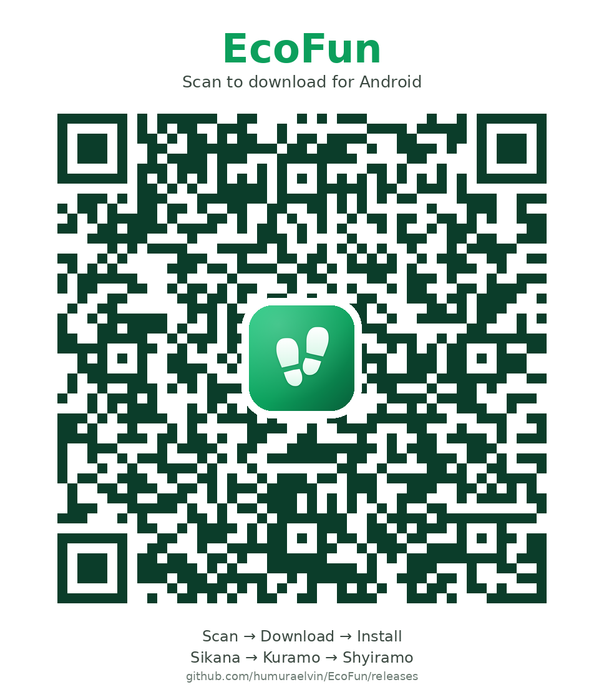

# EcoFun

EcoFun is a Flutter app that turns climate awareness into a small daily habit for people in Rwanda:

1. **Read** environment and climate stories from Rwandan newsrooms, in English or Kinyarwanda.
2. **Quiz** any time: 10 environment questions from an ever-growing AI question pool (English + Kinyarwanda),
   graded on the server. The first 3 quizzes each day earn 2 points per correct answer.
3. **Act**: a daily climate mission proven with a photo and a short story.

Plus an **AI waste scanner** (in-app camera → biodegradable or not, how to dispose of it in Rwanda; points are earned
only for *proper disposal*, verified by AI from a second photo), a **community** feed with star ratings (each rating
gives the author 1–5 points) and comments, a live **leaderboard**, **notifications**, and an **admin portal**.

**Admin portal** (sign in as an admin, e.g. the built-in `admin@ecofun.com`): live statistics and sign-up chart,
member search with full per-member stats, give/remove points, suspend/unsuspend, delete accounts, moderate every
shared photo, and announcements (English + Kinyarwanda with one-tap translation) delivered to every member's
notifications and optionally by email. Admins are notified of new members, deleted accounts and new posts.

Accounts exist in EcoFun only after the email code is verified; unfinished sign-ups are removed after an hour.

---

## Download (Android)

**Permanent link (always the newest version):**
https://github.com/humuraelvin/EcoFun/releases/latest/download/EcoFun.apk



1. Open the link (or scan the QR code) on an Android phone and download `EcoFun.apk`.
2. Open the downloaded file. If asked, allow your browser to *install unknown apps*.
3. If Play Protect warns about an unknown developer, tap **More details → Install anyway**.

The app checks for new versions on launch and offers a one-tap update.

### Publishing a new Android version
1. Bump `version:` in `pubspec.yaml` — the number after `+` must increase (e.g. `1.2.0+2010` → `1.2.1+2011`).
2. Run:
   ```bash
   NOTES_EN="What changed" NOTES_RW="Ibyahindutse" bash scripts/release-android.sh
   ```
   Add `--force-update` to require everyone to update. The script pushes the APK to the `apk-release`
   branch and the *Publish Android APK* workflow turns it into the GitHub Release (no personal token needed).
3. The release must be signed with the EcoFun key (`android/key.properties` + `android/app/ecofun-release.jks`,
   both git-ignored). **Back that key up** — without it, existing installs can't be updated.

---

## Architecture

| Layer | Technology |
|---|---|
| App | Flutter (Android + iOS), GetX for state/navigation, easy_localization (English + Kinyarwanda) |
| Auth | Supabase Auth — email/password with emailed codes, optional Google |
| Data | Supabase Postgres with Row Level Security; all points logic in `SECURITY DEFINER` SQL functions |
| Files | Supabase Storage buckets: `missions` and `scans` (private), `community` and `avatars` (public) |
| News | `refresh_news()` runs hourly in Postgres (pg_cron) and ingests RSS from Taarifa, Green Africa, KT Press, Rebero, Umuseke and Izuba Radio & TV |
| Email | Gmail SMTP for everything: Supabase Auth sends the 6-digit codes (EcoFun templates), and the `ecofun-mailer` Edge Function sends welcome, password-changed, streak and goodbye emails from an outbox table. English or Kinyarwanda, following the app language |
| Live | Supabase Realtime pushes new notifications to the app instantly |
| AI | NVIDIA API, called from Postgres (`http` extension); the key lives in Supabase Vault, never in the app |
| | Vision (scans + disposal proof): `nvidia/nemotron-3.5-super-vl-120b-a12b` (fallback `nemotron-3-nano-omni-30b`) · Quiz questions: `nvidia/nemotron-3.5-lightning-30b-a3b`, translated to Kinyarwanda with Google Translate; a cron job adds 10 new questions every 4 minutes |

```
lib/
  app/        app shell, routes, SessionController (today's progress), NewsController
  core/       theme (colours, type), reusable widgets, utils (formatting, image compression, photo picker)
  data/       Supabase client, models, repositories, storage service, auth
  features/   auth · shell · home · news · quiz · mission · scan · history · community · notifications · profile · admin
supabase/
  schema.sql          the complete database (run in the SQL editor)
  secrets.example.sql template for the git-ignored secrets.local.sql (NVIDIA key + mailer secret → Vault)
  functions/ecofun-mailer/   Edge Function that sends app emails through Gmail (templates.ts = email design)
  email-templates/    Supabase Auth code emails, generated by build.ts from the same design
  setup-email.sh      one-command email setup (SMTP, templates, function, secrets) via the Management API
```

Every rule that matters is enforced in the database: one quiz score and one mission per user per day
(Kigali time), answers never leave the server, users can only edit their own name/photo, ratings are once
per post and never on your own post, and only admins can grant points.

---

## Set up Supabase (once)

1. **SQL Editor → New query** → paste all of [`supabase/schema.sql`](supabase/schema.sql) → **Run**.
   The last line fills the news feed immediately and prints how many articles were saved.
2. Copy `supabase/secrets.example.sql` to `supabase/secrets.local.sql`, put your NVIDIA key in it, and run it
   the same way. (It stores the key encrypted in Vault.)
3. **Email (Gmail):** copy `supabase/mail.example.env` to `supabase/mail.local.env`, fill in your Gmail address,
   a Gmail [app password](https://myaccount.google.com/apppasswords), a random `MAILER_SECRET` (the same value as
   `mailer_secret` in `secrets.local.sql`) and a Supabase [access token](https://supabase.com/dashboard/account/tokens), then run:
   ```bash
   bash supabase/setup-email.sh --preview
   ```
   It re-applies the schema and secrets, deploys the `ecofun-mailer` function, switches Supabase Auth to Gmail
   SMTP with the EcoFun code templates (6-digit codes, email confirmation on) and mails you a preview of each app email.
4. Doing it by hand instead: **Authentication → Emails → SMTP Settings** → host `smtp.gmail.com`, port `465`,
   your Gmail and app password, sender name `EcoFun`. Then paste each file in `supabase/email-templates/` into the
   matching template under **Authentication → Emails** (subjects are in `manifest.json`), and deploy the function with
   `supabase functions deploy ecofun-mailer --no-verify-jwt` plus the secrets listed at the top of its `index.ts`.

   Gmail sends up to about 500 emails a day; for more, use a transactional provider with the same settings.
5. Admins: the built-in admin account is created with the Auth admin API (Dashboard → Authentication → Add user,
   email `admin@ecofun.com`, "Auto confirm"); `schema.sql` marks it as admin. To make anyone else an admin:
   ```sql
   update public.profiles set is_admin = true
   where id = (select id from auth.users where email = 'admin@example.com');
   ```
6. Optional — Google sign-in: create OAuth clients in Google Cloud (Web + Android with your SHA-1), enable
   Google in Supabase with the Web client ID, and put that ID in `GOOGLE_WEB_CLIENT_ID`.

## Run the app

```bash
cp assets/config/.env.example assets/config/.env   # then fill in your Supabase URL + publishable key
flutter pub get
flutter run --release        # release mode is the smooth, low-memory build
```

The app is tuned for low-end phones (2 GB RAM, 32-bit ARM): native system fonts (no bundled font files),
images decoded at display size, a capped image cache, lazily built tabs, compressed uploads (~100 KB) and
offline caches for the home screen and news.
